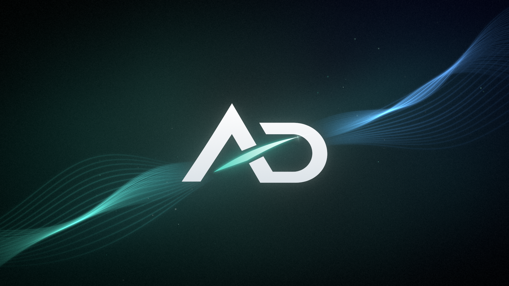
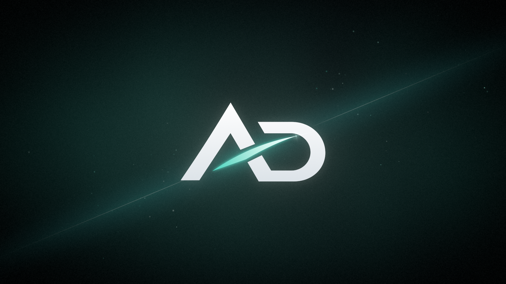

# AD — фон экрана загрузки

Замена стандартному экрану Mojang (красный фон с логотипом) в фирменном стиле AD.
Логотип перерисован в чистый вектор, поэтому он чёткий в любом разрешении.

## Aurora — основной вариант

Лента света (бирюзовый → синий) проходит сквозь логотип и сходится во «взмах».



| Размер | Файл |
| --- | --- |
| 1920×1080 | [ad-loading-aurora-1920x1080.png](ad-loading-aurora-1920x1080.png) |
| 2560×1440 | [ad-loading-aurora-2560x1440.png](ad-loading-aurora-2560x1440.png) |
| 3840×2160 | [ad-loading-aurora-3840x2160.png](ad-loading-aurora-3840x2160.png) |

## Blade — минималистичный вариант

Один тонкий луч по линии взмаха и немного звёздной пыли.



| Размер | Файл |
| --- | --- |
| 1920×1080 | [ad-loading-blade-1920x1080.png](ad-loading-blade-1920x1080.png) |
| 2560×1440 | [ad-loading-blade-2560x1440.png](ad-loading-blade-2560x1440.png) |
| 3840×2160 | [ad-loading-blade-3840x2160.png](ad-loading-blade-3840x2160.png) |

## Логотип

В папке [`logo/`](logo):

- `ad-logo.svg` — вектор, чёрный (как оригинал);
- `ad-logo-accent.svg` / `ad-logo-accent.png` — белые буквы и бирюзовый взмах, для тёмного фона;
- `ad-logo-white.png`, `ad-logo-black.png` — однотонные PNG 2048 px на прозрачном фоне.

## Как пересобрать

Картинки генерируются скриптом из [`source/`](source) (Python 3 и Node.js с Playwright/Chromium).
Цвета и параметры эффектов меняются в `source/designs.py`.

```bash
cd source
pip install -r requirements.txt
python build.py            # всё
python build.py aurora     # только один вариант: aurora | blade | logo
```

## В игре

Ванильный Minecraft не даёт заменить экран Mojang ресурспаком (логотип всегда берётся из самой игры),
поэтому для установки этого фона нужен мод, который умеет ставить свою картинку на экран загрузки.
